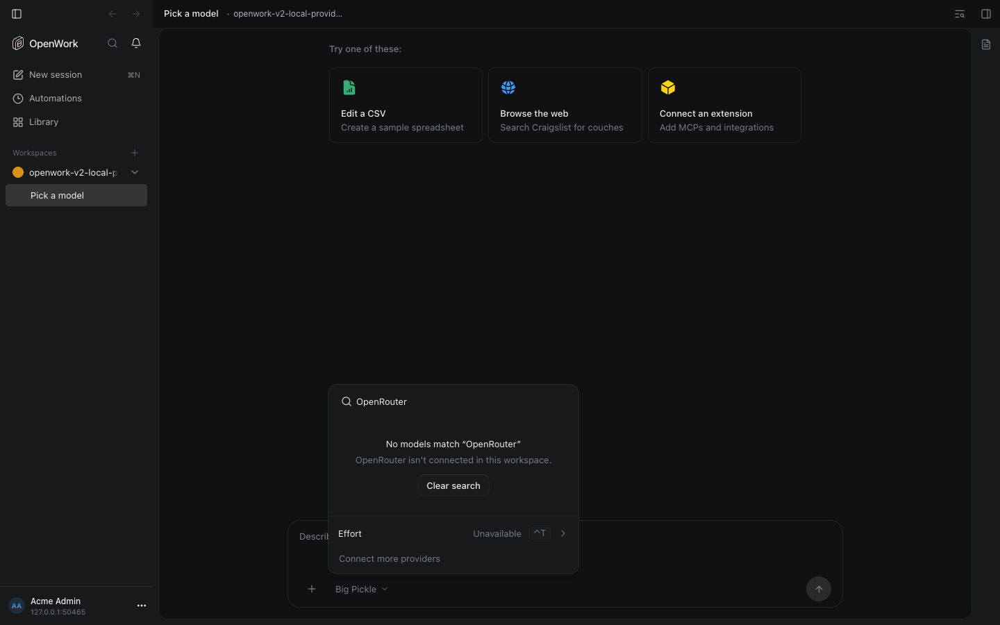

# Providers added on this computer, on OpenCode v2

Feature key `localProviderMirror` · cloud and self-hosted · default off ·
author `benjaminshafii` · follow-up: ENG-888.

## What changes

People add their own API keys in Settings › AI Providers (OpenRouter, OpenAI,
Anthropic…). OpenWork saves them in OpenCode v1's credential store and mirrors
them into OpenCode v2, the engine chat runs on. The bundled v1 engine now
describes providers as `Provider.Info` (package and endpoint on each model,
`capabilities` instead of `tool_call`/`modalities`), which the mirror could not
read, so every personal key was dropped and never reached the chat's model
picker.

With the feature on, for the signed-in member:

- The mirror translates v1's `Provider.Info` (and still accepts the older
  models.dev shape). The key comes only from `auth.json`; the catalog's copy of
  a key, its `baseURL` and its headers are ignored, and a catalog endpoint is
  used only on the adapter's own origin (`https://openrouter.ai` for
  OpenRouter, for example).
- Nothing is dropped silently. `GET /experimental/engine-v2-preview/status`
  adds `skippedProviders: [{ id, reason }]`, with `reason` one of `policy`,
  `oauth`, `unsupported`, `metadata` or `credentials`.
- After a key is saved or a provider sign-in finishes, the server mirrors it
  into v2 and rebuilds v1's provider list for that folder (never while v1 runs
  work), so AI Providers and the picker agree right away.
- AI Providers reads the skipped list: a sign-in v2 cannot use yet (ChatGPT,
  for example) reads "Not available on the new engine yet", and a provider the
  organization does not allow keeps its row with a lock and "Acme manages AI
  providers" (the organization's name). A skipped provider never reads "Ready
  to use".

Independently of the feature, "Only models you provide"
(`allowCustomProviders: false`) now applies to the v2 mirror exactly as v1's
`enabled_providers` does: only organization providers (`lpr_`, `ipr_`,
`openwork`, and OpenCode Zen unless removed) reach v2. Both engines use one rule
(`apps/server/src/organization-provider-gate.ts`).

| Off (today) | On |
| --- | --- |
|  |  |

## How to try it

Turn it on for one organization in `/admin`, sign in on a desktop that runs
chat on OpenCode v2, add an OpenRouter key in Settings › AI Providers, then
open the model picker in a chat and search "OpenRouter". The proof
`evals/proofs/v2-local-provider-mirror.proof.test.ts` drives the same path.

Signed out there is no organization, so the feature stays off until it ships
on by default.

## Turning it off

The next mirror (within a cloud provider sync, at most a few minutes, or the
next key change or restart) goes back to the older pass-through: personal keys
leave the v2 picker again and AI Providers stops reading skip reasons. Saved
keys, chats and the organization rule are untouched.

## What to watch

- `skippedProviders` in the engine status: a growing `metadata` count means v1
  changed its catalog shape again; `unsupported` lists providers without a v2
  adapter in the mirror (Google, Groq, custom gateways).
- Server log warning "Could not refresh OpenCode v1 providers after a provider
  change." means AI Providers may show a stale list until a restart.
- Out of scope here (ENG-888): sharing a personal provider with the team,
  asking an admin, and signing in again with OAuth on v2.
