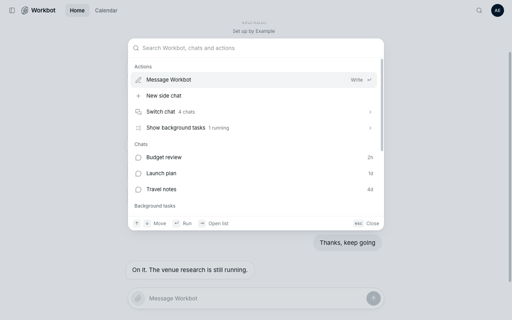
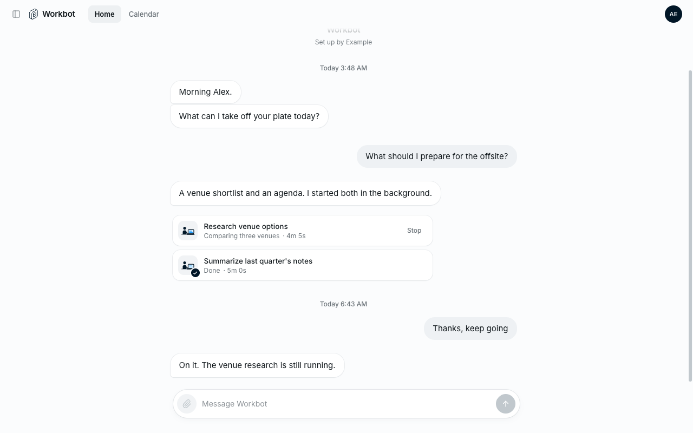

# Workbot: command palette

- Feature key: `workbotCommandPalette`
- Deployments: cloud and self-hosted, off by default
- Author: @benjaminshafii

Members press **Cmd+K** (macOS) or **Ctrl+K** (Windows, Linux), or the search
button in Workbot's header, to search and run what Workbot already does from
its visible controls:

| Group | Entries | Enter | Cmd/Ctrl+Enter |
| --- | --- | --- | --- |
| Actions | Message Workbot, Stop the reply (while answering), New side chat, Switch chat ›, Show background tasks ›, Show files | Run | |
| Chats | Main chat and side chats (four most recent; all when searched) | Open | Open in a new tab |
| Background tasks | Running tasks of this chat (finished ones when searched) | Show the task card | Stop it |
| Go to | Home, Calendar, Documents, Computer (the ones this person has) | Open | |
| Settings | Your dashboard, Your connections (Den pages the header links to) | Open | Open in a new tab |

Recently used entries come first. Tab opens a nested list (Switch chat,
Show background tasks); Backspace on an empty search, Shift+Tab or Esc goes
back. Ctrl+N / Ctrl+P move like the arrow keys. Esc closes and focus returns
where it was (usually the message box).

With the feature off nothing changes: no header button, the shortcut does
nothing, and no extra request is made.

## How it works

- Den reports `commandPalette` on `GET /v1/workbot/session` from the feature;
  Workbot passes it through `GET /v1/workbot/me` (off while Workbot itself is
  off) to `WorkbotHost.commandPalette`.
- `ee/packages/workbot-ui/src/command-palette.tsx` renders it with Base UI
  `Dialog` and inline `Autocomplete` (combobox, listbox, active descendant,
  live result count). Ranking and recents are in `command-palette-search.ts`
  (fuzzysort, the desktop palette's approach), tested in
  `ee/apps/workbot/scripts/command-palette.test.ts`.
- No new server routes. Chats come from `GET /v1/workbot/chats` (already used
  by the Chats drawer), tasks from the conversation already on screen; Stop
  calls the task card's existing stop route.
- Recents are kept in this browser's local storage
  (`workbot.command-palette.recents`, entry ids only).

## Turning it off

Safe at any moment: the next `/v1/workbot/me` read hides the button and the
shortcut. Nothing is stored on the server, and an open palette simply closes
on the next page load.

## Proof

`evals/proofs/workbot-command-palette.proof.test.ts` (`pnpm evals:e2e
workbot-command-palette --local`) drives the real Workbot page headless:
feature off, Cmd+K from the composer, loading, search with highlights, nested
Chats list, no results, Cmd+Enter stopping a task, Enter opening Calendar,
recents, and a 390px phone.
