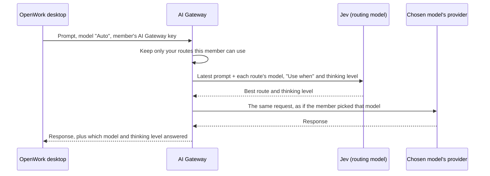

Auto Model Routing lets members choose **Auto** instead of a specific model. For every prompt, OpenWork picks one of the models you listed, and how hard it should think, based on what the prompt asks for. Quick questions go to a fast, inexpensive model. Hard coding, planning or debugging goes to your strongest model with more thinking.

You set it up once for the organization in OpenWork Cloud under **AI Gateway → AI Providers**. Members don't configure anything: Auto appears at the top of their model picker.

<Note>
Auto Model Routing is rolling out on OpenWork Cloud. If you don't see the **Auto Router** section, ask OpenWork to turn it on for your organization.
</Note>

## Why use it

- **Lower cost without thinking about it.** Members no longer run every small question through the most expensive model.
- **Better answers on hard work.** Difficult prompts get your strongest model and more thinking, even when a member forgot to switch.
- **One choice for members.** People who don't know the difference between models pick Auto and get a sensible model each time.
- **Same rules as any other model.** Auto only uses models already in your AI Gateway. Access, limits, usage counting and costs work exactly as if the member had picked the model themselves.

## Set it up

<Steps>
  <Step title="Add the models to your AI Gateway">
    Auto can only use models that are already in your AI Gateway, in an active model group. If you haven't yet, [add a provider](/cloud/share-with-your-team/managed-llm-provider) and its models first.
  </Step>
  <Step title="Enable the Auto Router">
    Open **AI Gateway → AI Providers**. The **Auto Router** section sits above your providers. Select **Enable**.

    <Frame caption="Before it is enabled, the Auto Router section explains what it does.">
      
    </Frame>
  </Step>
  <Step title="Add a model and describe when to use it">
    For each model you want Auto to use:

    - **Model**: choose one of your AI Gateway models.
    - **Thinking**: choose every thinking level Auto may use with this model. Only the levels the model supports are shown. **Default** uses the model's own setting.
    - **Use when**: describe, in plain words, the prompts this model should get. For example "Everyday questions, small edits and short answers", or "Hard coding tasks, architecture, debugging complex failures".

    Select **Save route**.

    <Frame caption="Each route names a model, the thinking levels Auto may use with it, and when to use it.">
      
    </Frame>
  </Step>
  <Step title="Add more models">
    Add a route for each model you want in the mix. Two or three routes with clearly different descriptions usually work best: a fast model for everyday work, a strong model for hard work, and optionally a model for a specialty such as reading images or long documents.

    <Frame caption="Saved routes show the model, its provider, when to use it and its thinking levels.">
      
    </Frame>
  </Step>
</Steps>

<Tip>
Write descriptions that separate the routes from each other. "Simple questions" and "Hard, multi-step coding and planning" route better than two descriptions that both mention coding.
</Tip>

## What members see

Members whose organization has the Auto Router enabled, and who have access to at least one of its models, see **Auto** as the first option in the desktop model picker. Auto manages thinking itself, so the effort control shows **Managed by Auto**.

<Frame caption="Auto is the first option in the model picker.">
  
</Frame>

Each reply shows which model answered it and at which thinking level, next to the reply's time.

<Frame caption="Each Auto reply names the model and thinking level that answered it.">
  
</Frame>

## How it works

Auto Model Routing runs inside the AI Gateway. Every Auto request still uses the member's own AI Gateway key, as described in [How requests flow](/ai-gateway/how-requests-flow).

1. **Only your models, only theirs.** The gateway starts from your routes and drops any model the member doesn't have access to.
2. **One decision per task.** At the start of each task (when the member sends a message), the gateway asks [Jev](https://docs.typesafe.ai/introduction/coding-agents), a fast routing model from TypeSafe, to choose one route and one thinking level. Jev sees the member's latest message and a short excerpt of the conversation, your route descriptions, model names and thinking levels. It never sees your provider ids or keys. The decision usually takes well under a second.
3. **Consistent within a task.** The steps that follow while the agent works on the task (tool results, follow-up calls) keep the same model and thinking level, so the model's context and prompt cache stay intact.
4. **Sent like a normal request.** The gateway forwards the request to the chosen provider exactly as if the member had picked that model: the same access checks, [limits](/ai-gateway/limits), [usage counting](/ai-gateway/counting-usage) and [costs](/ai-gateway/token-costs) apply, and the request log records the real model. Auto translates the request for the provider when needed, so Anthropic, OpenAI, Google Gemini, Amazon Bedrock, Azure OpenAI and OpenAI-compatible providers can all be mixed.
5. **A safe fallback.** If Jev can't answer in time, Auto uses the first route that allows **High** thinking, at High. If no route allows High, it uses your first route.

### Thinking levels

Each route can allow several thinking levels. More thinking gives better answers to hard problems but is slower and uses more tokens. Auto picks the least thinking it expects to answer the prompt well.

| Level | Typical use |
| --- | --- |
| Default | The model's own setting |
| None / Minimal | Trivial replies, as fast as possible |
| Low | Straightforward tasks |
| Medium | Typical tasks |
| High | Complex, multi-step work |
| Xhigh / Max | The hardest problems |

## Turn it off

Select **Turn off** in the Auto Router section. Auto disappears from members' model pickers the next time their app syncs with your organization, and requests already set to Auto stop routing. Your routes are kept, so turning it on again brings them back.

## Self-hosted

Auto Model Routing is offered on OpenWork Cloud first. Where it is available on a self-hosted install, give the AI Gateway a TypeSafe API key through the Helm chart's `secret.values.typesafeApiKey` (or the `TYPESAFE_API_KEY` key in your existing Secret). Without a key, Auto always uses its fallback route. See the chart's README for details.
